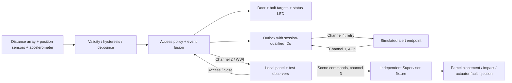
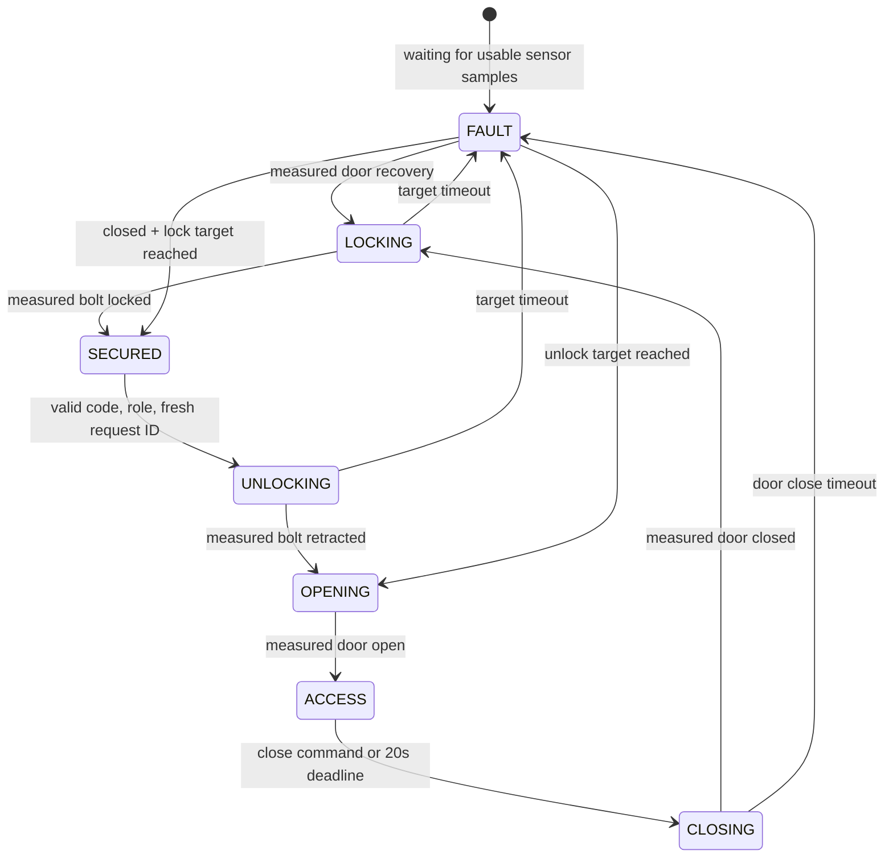

# Controller and simulation design

## Separation of responsibilities

The lockbox is an ordinary `Robot`, instantiated with `controller.Robot`. It cannot call Supervisor scene APIs or inspect parcel positions. Only the fixture and ground-truth scenario runners are Supervisors. The fixture creates stimuli and acknowledges events; it does not classify delivery, retrieval or tamper.

Fixture commands are available under Test controls in the local panel. They are not a production access-control surface. Separate radio channels carry status, commands, fixture actions and event packets.

## Sensor processing

Twenty-five downward generic distance sensors cover a 5×5 grid at −0.22, −0.11, 0, 0.11, 0.22 m. Webots performs bounding-object ray intersections. The lookup table includes 0.5% relative Gaussian noise. A parcel enters the present state below 0.40 m and leaves at or above 0.43 m, after three consistent device samples. At 32 ms, this requires up to 96 ms of stable samples. This rejects single-frame flicker and threshold chatter.

Door feedback is **closed below 0.05 rad**, **open above 0.15 rad**, and moving between those values. Bolt feedback is **locked at or above 74 mm**, **fully retracted at or below 6 mm**, and moving in between. A mid-stroke bolt cannot authorize door opening. Startup and recovery require three consecutive usable samples. Invalid samples reset the debounce count. All feedback must be finite; NaN/Inf feedback produces a sensor fault, revokes active access, and denies new access. Unavailable status values encode as JSON null so the panel can display them.

The accelerometer includes gravity. Idle readings are about 9.81 m/s²; the fixed impact threshold is 13.0 m/s² on the maximum absolute axis. Approved access motion is treated as context, and a 0.7-second post-close grace period covers settling. Unapproved impacts have a one-second refractory interval. This is rule-based event fusion, not a trained model.

## Phases and access

The public `secured` flag requires valid feedback, a closed door, a locked bolt, no active grant, no closing operation, and no sensor, door or latch fault. Phase names summarize state; the independent measured door/bolt values remain visible. `UNSECURED` represents an unapproved or unresolved open door.

Tokens are issued relative to policy-session start. Courier 2468 permits delivery, expires after 300 simulated seconds, is used upon grant, and cannot be used while a parcel is present. Owner 1357 permits one collection access and expires after 86,400 seconds. Both tokens are consumed on a successful grant; a fresh session reissues them. The requested role must match the token. Each access attempt requires a bounded nonempty request ID, cached for the session to reject replay. Concurrent grants are denied. Five failed credential attempts in 300 seconds trigger a 60-second cooldown; a valid credential does not bypass that cooldown.

A grant has a fixed 20-second deadline. Close requests and the deadline revoke it immediately, even if the door remains open. The door is commanded closed and the bolt stays retracted until measured closure. A three-second closing timeout reports `door_fault`; late parcel movement is unapproved. A close request during unlocking also cancels the grant. A remembered `door_was_open` flag preserves the access cycle through the intermediate door-angle band, allowing re-locking only after closed feedback. Successful closure clears a door fault and emits `door_recovered`. Impact filtering allows up to three seconds of closing motion, followed by 0.7 seconds of settling after closure. An impact below the separate 35 m/s² severe threshold may go undetected during this interval. Strong impacts bypass the grace interval and revoke active access.

These are simulated credentials, stored as demo PINs in local code. Production cryptography, remote provisioning and credential storage are outside scope.

## Event classification

- **Parcel detected:** a debounced empty→present transition during courier-authorized open-door handling marks delivery pending.
- **Delivery:** the pending parcel remains present and door/bolt feedback confirms closure and locking without a grant or fault.
- **Retrieval:** a present→empty transition during owner-authorized open-door handling.
- **Tamper:** an unapproved door-open edge, unapproved parcel transition, or threshold-crossing impact outside approved handling/grace; a severe impact is classified even during approved handling.
- **Benign motion:** approved handling without a delivery, retrieval or tamper event.

Parcel detection is logged immediately; delivery is committed after both position sensors confirm closure and locking. Retrieval is logged at the authorized removal edge. A delivery event records a completed transaction; current `secured` status can change if the box is opened later. The baseline classifies observed motion alone and does not receive access or parcel context.

## Outbox and endpoint protocol

Each session receives a random namespace and each event a monotonic integer ID. Queue entries contain session, ID, simulation timestamp, kind, reason, and a sensor timestamp where applicable. IDs are never logged with access PINs.

Runtime uses `auto_ack=False`. The adapter sends pending events to the independent simulated endpoint on channel 4, up to 16 per batch, retrying every 0.25 simulated seconds. The endpoint commits the alert payload to a SQLite receipt keyed by `(session, ID)`, then ACKs. A retry that finds an existing receipt receives another ACK and leaves the original row untouched. Failed writes leave the sender waiting for an ACK and able to retry. The interactive world uses `.runtime/alert-receipts.sqlite3`; evaluation worlds default to in-memory receipts unless `PARCEL_GUARD_RECEIVER_PATH` sets an isolated database. A valid ACK moves that event from pending to delivered; duplicates and wrong-session ACKs are ignored. Offline mode suppresses transmissions and ACK acceptance while sensing and event creation continue.

The benchmark checks every expected tamper ID against both the sender's acknowledged list and the endpoint's unique receipts. It also drops five ACKs and verifies retries, a drained queue and unique receipts. "Exactly once" refers to unique event processing at the endpoint; packets can be sent more than once.

The interactive world checkpoints the queue and replay cache in `.runtime/lockbox-state.json`; evaluation worlds use memory unless assigned an isolated store. `runtime_events.jsonl` remains a separate audit export. Restart restores the saved policy session; an explicit new session gets a new namespace after the queue drains. See the Progress Report 2 recovery section below.

## Actuator faults

Bolt targets continue to be commanded in jam tests while available motor force is zero and a Brake resists passive slider motion. The slider is attached to the door and has physical stops beyond its commanded endpoints. If the measured target is not reached after two seconds, `latch_fault` is emitted and `secured` is false even if the door is closed. Releasing the fixture obstruction removes the brake and restores available force. The fault clears and emits `latch_recovered` only when position feedback reaches the requested endpoint.

The hinge has physical stops at -0.02 and 1.40 rad with damping 0.1. The motor permits positions from 0 to 1.35 rad; the controller commands 0 rad for closed and 1.20 rad for open. The stop margin avoids numerical contact at the normal closed target. A zero-angle stop produced false impacts in a retained failed development diagnostic.

The animated door and bolt demonstrate commands, dynamics, timeouts and measured feedback. They do not model a certified physical lock or the strength of the enclosure against forced entry.

## Tests and recordings

Development and final scenarios have separate fixed seeds. Final detection is balanced across 25 empty and 25 occupied states with varied parcel sizes and boundary placements; final event recognition has 15 sequences per class. Parameters and source hashes are held fixed during each complete evaluation run. Reports preserve all trials and failures, with six CSV exports.

Native movie recordings are paired with per-frame observed controller status. Remotion reads those sidecars to show phases, real sensor values, queue length and endpoint receipt counts. Device status is published every 96 ms, so presentation panels can lag physical motion by that interval. Full raw telemetry and unedited movies are included.

## Remaining limits

A finite but stuck sensor value cannot be reliably distinguished from a real static state without added redundancy. Noise and geometry sweeps cover the stated simulated parcel envelope; they do not establish performance on real parcels. Tests use local simulated connectivity and deterministic scenario generation, not real deployment data or an optimized machine-learning comparator.

## Reset behavior

After all pending events have been acknowledged, a new session reissues both temporary codes and clears the session history, replay IDs and pending delivery. A reset with pending events is rejected and logged. If the door is open, the controller revokes access, commands closure, and holds the bolt retracted until the closed sensor condition is reached. Reset does not move the parcel. The Webots edge suite tests this path and a complete offline delivery/retrieval with a blocked bolt.

## Recording the interface

The normal Webots Robot Window uses WWI. The video recorder serves that same HTML page through a loopback-only HTTP bridge with a per-run token. Browser form and button handlers send commands to the scenario runner, which forwards them to the ordinary controller. Sensor status comes back over the existing status channel. The browser never invents access outcomes or sensor readings. The recorder advances one 32 ms simulator step at a time and captures the page every third step, keeping native footage, interface footage, and telemetry aligned. This transport exists only during recording.

Animated parcel placement follows waypoints outside the box and through the centre of the open front. It remains a scripted fixture; it is not a model of a courier’s hand or a general collision-free manipulation planner.

## Progress Report 2: recovery and sensor faults

The current interactive controller uses `lockbox/storage.py` for a local JSON checkpoint. It records the event session and next ID, history, pending/delivered membership, consumed-code flags, token deadlines, replay IDs, failed-attempt times, cooldown, link state and recovery count. A checksum detects accidental damage; it is not authentication. Writes flush and fsync a temporary file, atomically replace the previous checkpoint, then fsync the containing directory. Unchanged policy state does not rewrite the file every device tick.

`Lockbox(state_path=...)` restores this state; the interactive Webots world enables it by default. Other worlds use memory unless `PARCEL_GUARD_STATE_PATH` is explicitly set. Active grants, pending delivery confirmation and sensor debounce state do not survive a restart. Recovery commands closure, retains bolt retraction while the door is open, and requires fresh stable feedback before secured status. A storage read/write fault denies access and is visible in the panel. Starting a new session is refused while events await acknowledgment, avoiding an accidental outbox discard.

The controller assigns a world epoch through Robot custom data. Controller restart retains that epoch; a new/reset world starts a different epoch. If the epoch changes or simulation time rewinds, previous credentials expire rather than gaining a new lifetime. Cooldown and failure counts are retained conservatively. `New session` deliberately provisions fresh demo codes after the queue drains. The state file is local, not encrypted; demo PINs remain a course simulation.

A separate 35 m/s² threshold detects strong acceleration even during an access grant, closing motion or post-close grace. It uses the same refractory interval and revokes an active grant. Valid acceleration can still produce an alarm when another device has invalid feedback. The ordinary 13 m/s² threshold retains the original authorization context. These fixed values are tested in the model and require physical calibration.

Range checks accept distance readings from 0 to 0.65 m, door angles from -0.06 to 1.50 rad and bolt readings from -0.02 to 0.10 m. These bounds include margin around the modeled travel and sensor noise. Invalid values reset startup/recovery stability counts, deny access and prevent secured status. Frozen bolt feedback is detected when commanded motion fails its existing timeout. A plausible frozen parcel array, or a frozen joint reading already matching the commanded target, is not reliably diagnosable with this sensor set.

The new fixture can restart the real box controller, inject an out-of-range distance, freeze bolt feedback or apply a stronger door-relative force. The ordinary Robot still cannot inspect scene coordinates; only the separate Supervisor fixture performs these test actions. `webots_progress2.json` records scenario assertions. `progress2_regressions.json` includes abrupt child-process exit and injected storage failures. The follow-up in `webots_alert_recovery.json` verifies the receiver reloads its stored alert and the sender restores the pending copy after both controllers restart. After reconnecting, the retry receives an ACK and the receipt count stays at one. The trial uses local files and covers controller-process restarts.

## Layered security and owner workflow

The default interactive world enables `SecurityPolicy` from `lockbox/security.py`. Legacy door-entry PINs are disabled. The owner signs in using only the owner password, checked with PBKDF2-HMAC-SHA256 (200,000 iterations and a random salt). No authenticator or second device is required. Five failed logins pause sign-in for 60 simulated seconds; throttling state survives restart. An immediate successful repeat sign-in is allowed and invalidates the old owner session.

Owner sessions are random bearer tokens, valid for 300 simulated seconds, held only in memory and returned to the requesting Robot Window. Tokens are absent from shared status and audit exports. Test Supervisors receive replies on a separate fixture channel; this is not encrypted/authenticated network transport. Sessions are discarded on restart or tampering. The local host and fixture remain trusted.

An authenticated owner can issue an eight-digit one-use code for either courier delivery or owner collection, valid for 30 to 3600 simulated seconds. A keyed digest is stored, while plaintext is returned once to the requester. Credential metadata supports revocation and status without revealing codes. Role mismatch does not consume a valid code. Code use is committed before an access grant can open the door. A new issued code supports another cycle in the same policy session. The bounded demonstration history holds 128 issued credentials.

In security mode every tamper event revokes all issued credentials, invalidates owner sessions and enters persistent lockdown. Active access ends; motor control still requires measured closure before extending the bolt. The public `secured` value describes physical closure/locking; phase `LOCKDOWN` additionally means access is administratively blocked. Clearing lockdown requires a new password-authenticated owner session and a physically secured, fault-free enclosure. Previously revoked codes remain revoked and must be replaced. `reset_logic` is denied in security mode, and world restarts retain the incident through the checkpoint.

The existing checkpoint schema is upgraded in place when the security field is absent, retaining pending events and IDs. New/reset world epochs revoke issued credentials. Recovery never restores owner sessions. The checkpoint is created with the private permissions of its temporary file but is not encrypted, signed by an external authority or protected against malicious host rollback.

`tests/security_layers.py` checks password-only sign-in, saved-state migration and adversarial policy cases. `delivery_box_security.wbt` / `security_runner` separately exercises the default security workflow with measured feedback. The original acceptance worlds intentionally retain legacy credentials for comparison.

The embedded security checkpoint upgrades from version 1 to version 2 by retaining the old digest-key bytes under `credential_key` and removing the unused authenticator fields. Password verifiers, issued codes, revocations and incidents are preserved; no reset or re-enrollment is needed.
