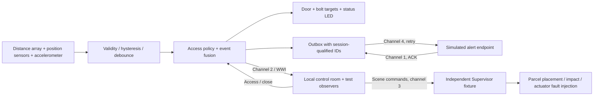
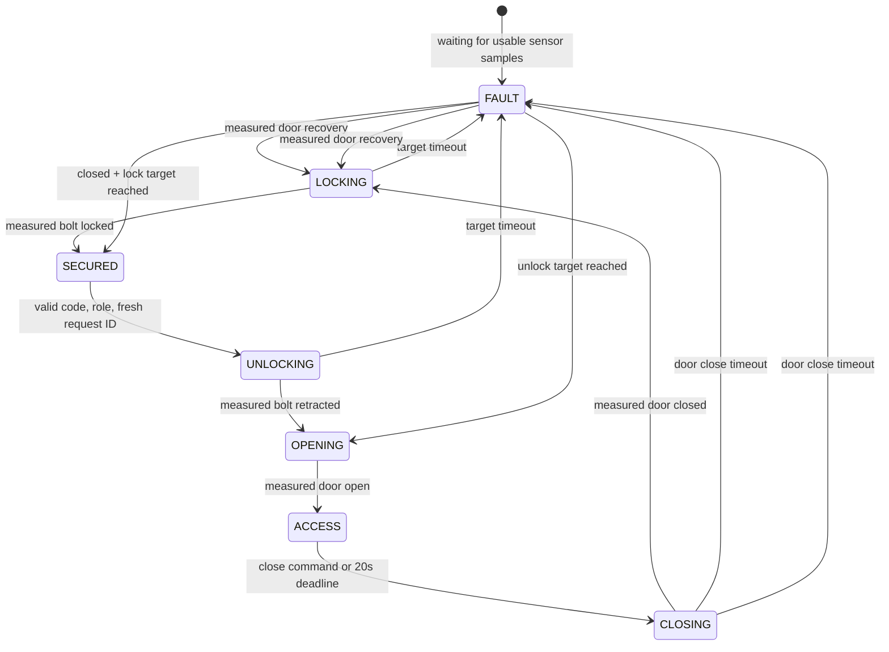

# Controller and simulation design

## Separation of responsibilities

The lockbox is an ordinary `Robot`, instantiated with `controller.Robot`. It cannot call Supervisor scene APIs or inspect parcel positions. Only the fixture and ground-truth scenario runners are Supervisors. The fixture creates stimuli and acknowledges events; it does not classify delivery, retrieval or tamper.

Fixture commands are explicitly available in the scenario lab for this simulation. They are not a production access-control surface. Separate radio channels carry status, commands, fixture actions and event packets.

## Sensor processing

Twenty-five downward generic distance sensors cover a 5×5 grid at −0.22, −0.11, 0, 0.11, 0.22 m. Webots performs bounding-object ray intersections. The lookup table includes 0.5% relative Gaussian noise. A parcel enters the present state below 0.40 m and leaves above 0.43 m, after three consistent device samples. At 32 ms, this requires up to 96 ms of stable samples. This rejects single-frame flicker and threshold chatter.

Door feedback is **closed below 0.05 rad**, **open above 0.15 rad**, and moving between those values. Bolt feedback is **locked at or above 74 mm**, **fully retracted at or below 6 mm**, and moving in between. A mid-stroke bolt cannot authorize door opening. Startup and recovery require three consecutive usable samples. Invalid samples reset the debounce count. All feedback must be finite; NaN/Inf feedback produces a sensor fault, revokes active access, and denies new access. Unavailable status values encode as JSON null so the panel can display them.

The accelerometer includes gravity. Idle readings are about 9.81 m/s²; the fixed impact threshold is 13.0 m/s² on the maximum absolute axis. Approved access motion is treated as context, and a 0.7-second post-close grace period covers settling. Unapproved impacts have a one-second refractory interval. This is rule-based event fusion, not a trained model.

## Phases and access

The public `secured` flag requires valid feedback, a closed door, a locked bolt, no active grant, no closing operation, and no sensor, door or latch fault. Phase names summarize state; the independent measured door/bolt values remain visible. `UNSECURED` represents an unapproved or unresolved open door.

Tokens are issued relative to policy-session start. Courier 2468 permits delivery, expires after 300 simulated seconds, is redeemed upon grant, and cannot be used while a parcel is present. Owner 1357 permits collection and expires after 86,400 seconds. The requested role must match the token. Each access attempt requires a bounded nonempty request ID, cached for the session to reject replay. Concurrent grants are denied. Five failed credential attempts in 300 seconds trigger a 60-second cooldown; a valid credential does not bypass that cooldown.

A grant has a fixed 20-second deadline. Close requests and the deadline revoke it immediately, even if the door remains open. The door is commanded closed and the bolt stays retracted until measured closure. A three-second closing timeout reports `door_fault`; late parcel movement is unapproved. A close request during unlocking also cancels the grant. A remembered `door_was_open` flag preserves the access cycle through the intermediate door-angle band, allowing re-locking only after closed feedback. Successful closure clears a door fault and emits `door_recovered`. Impact filtering allows up to three seconds of closing motion, followed by 0.7 seconds of settling after closure. This suppression has an acknowledged adversarial blind spot during approved handling.

These are simulated credentials, stored as demo PINs in local code. Production cryptography, remote provisioning and credential storage are outside scope.

## Event classification

- **Delivery:** a debounced empty→present transition during courier-authorized open-door handling.
- **Retrieval:** a present→empty transition during owner-authorized open-door handling.
- **Tamper:** an unapproved door-open edge, unapproved parcel transition, or threshold-crossing impact outside approved handling/grace.
- **Benign motion:** approved handling without a delivery, retrieval or tamper event.

The event outcome is recorded when the sensor transition occurs. A delivery event alone does not mean the box is locked: `secured` must subsequently be confirmed by both position sensors. The baseline classifies observed motion alone and does not receive access or parcel context.

## Outbox and endpoint protocol

Each session receives a random namespace and each event a monotonic integer ID. Queue entries contain session, ID, simulation timestamp, kind, reason, and a sensor timestamp where applicable. IDs are never logged with access PINs.

Runtime uses `auto_ack=False`. The adapter sends pending events to the independent simulated endpoint on channel 4, up to 16 per batch, retrying every 0.25 simulated seconds. The endpoint records each `(session, ID)` once and ACKs all accepted packets, including retries. A valid ACK moves that event from pending to delivered; duplicates and wrong-session ACKs are ignored. Offline mode suppresses transmissions and ACK acceptance while sensing and event creation continue.

The benchmark checks every expected tamper ID against both the sender's acknowledged list and the endpoint's unique receipts. It also drops five ACKs and verifies retries, a drained queue and unique receipts. "Exactly once" refers to unique event processing at the endpoint; packets can be sent more than once.

The queue and replay cache are in memory. `runtime_events.jsonl` is an audit export. It is not replayed automatically after restart. A new policy session gets a new namespace; restart persistence is not claimed.

## Actuator faults

Bolt targets continue to be commanded in jam tests while available motor force is zero and a Brake resists passive slider motion. The slider is attached to the door and has physical stops beyond its commanded endpoints. If the measured target is not reached after two seconds, `latch_fault` is emitted and `secured` is false even if the door is closed. Releasing the fixture obstruction removes the brake and restores available force. The fault clears and emits `latch_recovered` only when position feedback reaches the requested endpoint.

The hinge has physical stops at -0.02 and 1.40 rad with damping 0.1; motor commands remain between 0 and 1.35 rad. The stop margin avoids numerical contact at the normal closed target. A zero-angle stop produced false impacts in a retained failed development diagnostic.

The animated door and bolt demonstrate commands, dynamics, timeouts and measured feedback. They do not model a certified physical lock or the strength of the enclosure against forced entry.

## Evidence and video provenance

Development and final scenarios have separate fixed seeds. Final detection is balanced across 25 empty and 25 occupied states with varied parcel sizes and boundary placements; final event recognition has 15 sequences per class. Parameters and source hashes are held fixed during each complete evaluation run. Reports preserve all trials and failures, with six CSV exports.

Native movie recordings are paired with per-frame observed controller status. Remotion reads those sidecars to show phases, real sensor values, queue length and endpoint receipt counts. Device status is published every 96 ms, so presentation panels can lag physical motion by that interval. Full raw telemetry and unedited movies are included.

## Remaining limits

A finite but stuck sensor value cannot be reliably distinguished from a real static state without added redundancy. Noise and geometry sweeps cover the stated simulated parcel envelope; they do not establish performance on real parcels. Tests use local simulated connectivity and deterministic scenario generation, not real deployment data or an optimized machine-learning comparator.
