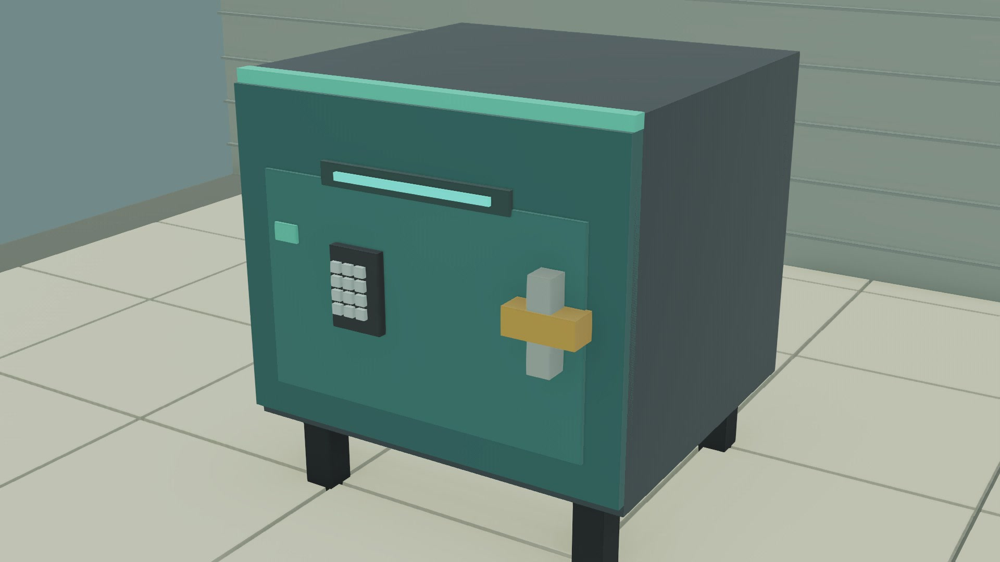
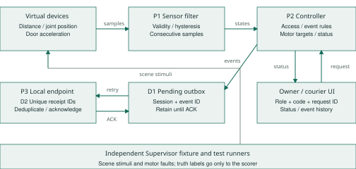

# Parcel Guard

Repository copy of the report. The submission paper is [the standalone LaTeX source](parcel_guard_report.tex), exported as the [final report PDF](../output/pdf/Parcel%20Guard%20-%20Final%20Report.pdf).
## Package Delivery Security Box

CS 5650 · Final project · Webots simulation

Instructor: Dr. Jung Soo Lim · Fall 2026

Joshua Guico · Joe Jimenez · Brandon Lopez

October 17, 2026

A single-parcel lockbox with measured door and bolt feedback, temporary courier access, event detection, and recovery after simulated message loss.

**Project repository:** https://github.com/joejimenez-lab/parcel-guard-webots

**Submission contents:** final report, presentation with speaker notes, Webots worlds and Python controllers, local Robot Window, reproducible tests, saved results, and a complete captioned walkthrough and two short demonstration clips.

# Contents and abstract

The paper follows introduction and team responsibilities; related work; architecture and data flow; control design; evaluation method; results; conclusions; reproduction; and references. Its PDF contains an automatically generated table of contents.

## Abstract

Parcel Guard models a package-delivery security box in Webots R2025a. The controller grants temporary courier access, detects a parcel arriving or leaving, and reports the box as secured only after its door and bolt reach their measured endpoints. An independent Supervisor places parcels, applies disturbances, disables actuators, and labels trials. The detector uses virtual device readings rather than scene coordinates.

The final evaluation includes 50 parcel-presence trials, 60 event sequences, 100 complete motor cycles, 30 alert-timing trials, 10 message outages with 100 alerts, and 30 invalid access attempts. The controller achieved @PRESENCE@ correct presence decisions, macro F1 @F1@, and @FALSE@ false tamper alarms among 45 non-tamper sequences. All @CYCLES@ motor cycles completed. All 100 outage alerts reached the simulated endpoint once by event ID, despite retransmission. The access trials produced zero unauthorized unlocks.

Additional checks cover bolt faults in both directions, an obstructed door, access expiry, early cancellation, lost acknowledgments, sensor startup and gaps, and malformed commands. These results apply to the generated simulation scenarios. The project does not establish physical attack resistance, production authentication, real radio performance, or recovery after a process restart.

# 1. Introduction

## Problem and intended users

A delivery notification tells an owner that a carrier recorded a delivery. It does not establish whether a parcel is inside a particular container or whether that container has closed and locked. Parcel Guard examines those two states directly in a repeatable simulation.

The intended users are an owner collecting a parcel and a courier depositing one. The course team acts as the project stakeholder; the proposal names no external customer, sponsor, liaison, or advisor. The delivery sequence requires a valid courier code, a measured parcel transition, a closed door, and a locked bolt. Owner access permits retrieval. An unexplained opening, parcel movement, or sufficiently large impact creates a suspected-tamper event.

## Scope and design principles

The project contains one virtual box and one parcel at a time. Python controls the door and bolt, reads the devices, enforces access rules, and maintains an event outbox. A local Webots Robot Window provides code entry, measurements, event history, and clearly separated scenario controls. The project uses no purchased hardware or external cloud service.

Position sensors determine whether the door and bolt have reached their targets. The detector reads devices, while a separate fixture sets up the trials and supplies labels to the scorer. Local sensing and access control continue when the simulated message link is offline.

## Team responsibilities and project organization

The responsibilities below are the planned allocation in the written September proposal. They describe assigned roles rather than a record of hours worked.

| Team member | Proposal responsibility and corresponding project area |
|---|---|
| Joshua Guico | Project & Integration Lead: tasks, communication, integration, demonstration, presentation, and report |
| Joe Jimenez | Simulation & Modeling Lead: enclosure, parcel, joints, sensors, and scenario modeling |
| Brandon Lopez | Controller, Interface & Testing Lead: Python policy, access rules, local panel, automated tests, and troubleshooting |
| All three | Integration review, interpretation of results, and final presentation |

The proposal organized work into modeling and sensor checks, controller/UI integration, and evaluation. The repository follows those boundaries in separate modules. The repository includes commands and trial records for repeating each test. The suggested presentation remains 13 minutes plus two minutes for questions.

# 2. Related works and technologies

## Existing approaches

Amazon Key describes a delivery workflow that verifies the package and driver's location before granting one-time garage access [1]. That approach connects access to a delivery transaction. Parcel Guard models the narrower rule of a single-use courier credential in a local environment. It does not implement Amazon's service, location verification, or carrier identity checks.

Yale's Smart Security Box manual describes app setup, entry-code management, shared access, and an optional Connect WiFi Bridge [2]. Parcel Guard checks bolt position for local access and uses an event outbox for message delivery. We did not test Yale or Amazon products, and the comparison below makes no claim about their error rates or relative security.

| Approach | Access and deployment | Evidence available in this project |
|---|---|---|
| Amazon Key [1] | Package/location verification and one-time garage access through a delivery service | Published workflow only; no direct product test |
| Yale Smart Security Box [2] | App-managed entry codes and shared access; optional WiFi bridge | Published manual only; no direct product test |
| Parcel Guard | Demo PINs with role, expiry, single use, replay rejection, and cooldown in Webots | Source, raw device readings, fault injection, and repeatable trial results |

## Technology choices

Webots provides simulated sensors, motorized joints, collision geometry, and a Supervisor interface. Its DistanceSensor can map ray intersections to readings and Gaussian noise [3]. PositionSensor measures hinge angles in radians and slider travel in meters [4]. The Accelerometer includes gravity-induced readings, which explains the approximately 9.81 m/s2 resting value [5]. Supervisor APIs support controlled scene changes and test observation [6].

Python keeps the policy independent of the Webots device adapter. The policy uses only the standard library and can be exercised without opening a world. A deterministic state machine fits the small number of access and parcel events and provides a reason for each denial or alert. A learned classifier would require a dataset and evaluation beyond this proposal.

The local HTML/JavaScript Robot Window reuses the bundled Webots bridge. The project retains its license notice. Webots records the actual simulation footage; Remotion assembles that footage with recorded telemetry and captions. Video editing dependencies are optional for running the simulation.

## Comparison used in evaluation

A motion-only alarm supplies a limited reference. It uses measured acceleration and door-angle range, but cannot identify delivery or retrieval without additional context. We therefore report both its four-class macro F1 and its non-tamper false alarms. It is deliberately a simple alarm rule, and its score should not be read as a benchmark against a trained classifier or commercial product.

# 3. System architecture

**Figure 1.** Data flow within the local simulation. Solid arrows carry measured data, requests, or events. The fixture changes the scene; ground-truth labels stay in the test runner. The ordinary lockbox Robot cannot inspect parcel coordinates.

## Components and interfaces

The device adapter reads 25 downward distance rays, door and bolt positions, and a door accelerometer every 32 ms. `SensorFilter` checks validity and stabilizes presence readings. `Lockbox` owns credential state, authorization, event rules, actuator targets, and the outbox. The adapter applies motor targets and publishes status every third step, or 96 ms.

The Robot Window sends access requests containing a role, code, and fresh request ID. It displays door, bolt, parcel, fault reason, and event-delivery state separately. Scene controls such as placing a parcel or disabling a motor are test-fixture controls. They are intentionally exposed for classroom demonstration and do not represent a deployed authentication boundary.

The independent fixture receives scene commands on channel 3 and event packets on channel 4. The simulated endpoint records each session-qualified event ID once, then sends an acknowledgment on channel 1. Status observers use channel 2. Webots' Robot Window interface carries local UI requests and status.

## Data and storage

An event contains a session namespace, monotonic integer ID, simulation timestamp, kind, and reason. Sensor-derived events also retain the sampled-event time and local queue latency. Runtime does not record entered PINs in the event log. Pending events remain in memory until the matching session and ID are acknowledged.

The adapter retries pending batches of up to 16 every 0.25 simulated seconds. Duplicate packets receive acknowledgments without creating another endpoint entry. The JSONL export supports inspection, but the controller does not replay it on restart. The outbox, used-code state, and replay cache are volatile. A new policy session intentionally resets them and issues fresh demo credentials.

# 3.1 Control logic and implementation

## Sensor interpretation

The distance array uses a 5 by 5 grid with coordinates -0.22, -0.11, 0, 0.11, and 0.22 m on each horizontal axis. Each generic ray uses 0.5% relative Gaussian noise. Presence enters when the minimum reading is below 0.40 m and leaves when it is at least 0.43 m. Three consecutive candidate readings confirm a change. Startup and recovery from invalid data also require three usable samples; a gap resets the debounce count.

The door is closed below 0.05 rad, open above 0.15 rad, and moving between those thresholds. The bolt is locked at or above 0.074 m and retracted at or below 0.006 m. Intermediate bolt travel cannot permit opening. Non-finite feedback disables access, ends an active grant, and produces a sensor fault. Status encoding converts unavailable readings to JSON null so the browser can display them without failing.

## Access and actuator sequence

| Phase or condition | Controller action and required evidence |
|---|---|
| Secured | Valid sensors, closed door, locked bolt, no grant or fault |
| Valid access request | Check role, token expiry, use state, replay ID, cooldown, occupancy, and secure starting state |
| Unlocking / opening | Retract bolt; wait for measured retraction before opening door |
| Authorized access | Interpret parcel transitions using the active role |
| Close or 20-second deadline | Revoke authorization immediately; close door; hold bolt retracted while door remains open |
| Locking | Extend bolt only after measured closure; confirm endpoint before reporting secured |
| Fault | Show the reason; recovery requires usable sensors or measured target completion |

Courier code 2468 expires after 300 simulated seconds and is consumed when access is granted. Owner code 1357 also works once and expires after 86,400 seconds. Both tokens are consumed on a successful grant. Each independent motor-cycle trial starts a fresh policy session. Expiry uses an exclusive upper bound, so a request exactly at the deadline is rejected. Five failed credential attempts within 300 seconds pause entry for 60 seconds. Replay IDs are rejected even when a code is otherwise valid.

A bolt target timeout is two seconds. A closing door has three seconds before a door fault. Physical hinge stops bound travel slightly beyond the motor's commanded range to avoid a stop fighting the normal closed target. The bolt moves with the door and has physical travel stops. Its failure fixture disables force and applies a brake so door motion cannot passively slide it into a false recovery. Door failures disable available torque.

## Event rules

An empty-to-present transition during courier-authorized open-door handling records `parcel_detected` and marks delivery pending. The `delivery` event is recorded only when the parcel remains present, the door is closed, the bolt is locked, and there is no active grant or fault. A jam leaves delivery pending; removal or suspected tampering cancels it. A present-to-empty transition during owner access creates retrieval. An unexplained opening or parcel transition creates tamper. An acceleration-axis magnitude above 13 m/s2 outside approved handling and settling also creates tamper. A one-second refractory interval limits repeated impact alerts. Closure has a 0.7-second settling grace period. Benign motion is the evaluated sequence outcome when no delivery, retrieval, or tamper event occurs.

# 4. Evaluation method

## Reproducible setup

The evaluated configuration uses Webots R2025a, a 32 ms timestep, and physics seed 42. Development event scenarios use seed 5650. Final event scenarios use seed 20260930; presence trials use seed 20260931. `config/evaluation.json` records thresholds and timing. The evaluation runner hashes source, generated worlds, test code, and UI files before and after the run, then hashes each report.

The seeds produce separate scenario realizations of the same test families. They do not produce an independent real-world dataset. Development tests guide fixes; final tests run only after the configuration is fixed. A retained diagnostic report records the failed hinge-stop experiment and its measured false alarms.

| ID | Requirement and acceptance criterion | Test design |
|---|---|---|
| R1 | Presence: at least 48 correct out of 50 | 25 empty and 25 occupied; vary size and position, including edge placements |
| R2 | Four-class macro F1 at least 0.90 | 15 final sequences each of benign motion, delivery, retrieval, tamper |
| R3 | False tamper alarms at most 2 out of 45 | All non-tamper final sequences form the denominator |
| R4 | At least 99 successful motor cycles out of 100 | Complete measured opening and closing cycles |
| R5 | At least 29 of 30 alerts queued within 1 s | First sampled impact crossing to local queue insertion |
| R6 | Recover all 100 offline events once | 10 outages, 10 distinct impact events per outage; inspect sender and receiver IDs |
| R7 | Zero unauthorized unlocks in 30 attempts | Six each: invalid, expired, reused, wrong role, replayed ID |
| R8 | Fault on blocked bolt, never false secured | Disable force and apply a brake in both directions; release and observe recovery |
| R9 | Five wrong attempts trigger 60 s cooldown | Check a valid code during and after the pause |
| R10 | Local entry, measured status, history and fixture controls | Robot Window; 14 DOM checks and browser layout review |
| R11 | Repeatable evaluation with saved failure details | Fixed seeds; separate development/final runs; source/report hashes and JSON/CSV records |
| R12 | Complete project and communication materials | Source, paper, presentation with notes, captioned demos, guides and portable archive |
| R13 | Record delivery only after measured closure and locking | Pending delivery, blocked-lock recovery, removal and offline workflow tests |
| R14 | Reset safely and resume local operation | Open-door reset revokes access and holds the bolt retracted until closure |

## Scoring and timing

For each class, F1 equals 2TP / (2TP + FP + FN). Macro F1 is the unweighted average across the four classes. Rows in the confusion matrix are expected labels; columns are predictions. If any tamper event occurs in a sequence, the scorer labels that sequence tamper before considering delivery or retrieval.

The motion-only reference predicts tamper when measured acceleration exceeds 10.2 m/s2 or door angle varies by more than 0.05 rad. It has no role or parcel input. The queue-latency metric excludes device sampling delay before the first observation, endpoint transport, dashboard rendering, and wall-clock execution. A second timing value measures stimulus-to-observer delay to make that distinction visible.

# 4.1 Results and comparison

| Measure | Observed result | Acceptance |
|---|---:|---|
| Parcel presence | @PRESENCE@ | Pass |
| Event macro F1 | @F1@ over 60 sequences | Pass |
| False tamper alarms | @FALSE@ / 45 non-tamper sequences | Pass |
| Complete motor cycles | @CYCLES@ / 100 | Pass |
| Local alerts within 1 simulated second | @LATENCY@ / 30 | Pass |
| Offline alerts processed once by ID | @RECOVERED@ / 100 | Pass |
| Unauthorized unlocks | @UNAUTHORIZED@ / 30 attempts | Pass |

## Final event confusion matrix

| Expected / predicted | Benign | Delivery | Retrieval | Tamper |
|---|---:|---:|---:|---:|
| Benign motion | @CM00@ | @CM01@ | @CM02@ | @CM03@ |
| Delivery | @CM10@ | @CM11@ | @CM12@ | @CM13@ |
| Retrieval | @CM20@ | @CM21@ | @CM22@ | @CM23@ |
| Tamper | @CM30@ | @CM31@ | @CM32@ | @CM33@ |

The measured motion-only reference achieved macro F1 @BASELINE@ and raised a tamper alarm for all 45 non-tamper sequences. Every sequence contains motion, so this rule cannot separate approved handling from an attack or distinguish delivery from retrieval. The comparison shows the value of access and parcel context for this test design. It does not establish a general accuracy advantage over other detection systems.

All 30 sampled impacts entered the local queue in the same controller iteration, giving 0 simulated seconds for sensor-sample-to-queue latency. Sampling runs every 32 ms. The independent observer received an alert within @OBSERVER@ simulated seconds of a stimulus. Zero queue latency therefore describes scheduling at the chosen resolution, rather than instantaneous physical or network response.

Both bolt-jam directions produced faults and recovered from measured feedback. A full offline workflow also confirmed delivery after a blocked bolt recovered, allowed local owner retrieval, and replayed all queued events once. Resetting an open box revoked access and kept the bolt retracted until closure. The separate door test revoked expired authorization, flagged parcel movement after expiry, kept the bolt retracted while open, and recovered after release. Early cancellation and malformed-command cases passed. The policy suite contains @REGRESSIONS@ targeted checks, and the dashboard suite contains 14 DOM checks.

These scores cover the generated scenes. The JSON reports retain each trial, and the CSV exports can be read without Webots. Different parcel shapes, handling, weather, and attacks require further tests.

# 5. Conclusions and future work

## What succeeded

The delivered simulation completes courier delivery and owner retrieval using measured device feedback. It rejects the required invalid access categories, distinguishes the four tested sequence types, reports actuator faults, and recovers retained alerts after simulated outages. The demonstration videos show actual Webots footage with status taken from the recording, and the full suite supplies the evidence beyond those selected examples.

The policy runs independently of Webots, so access and event rules can be checked with short input sequences. Simulator tests then check those rules against device feedback and actuator motion.

## Failures found and corrected

| Finding during final review | Correction and evidence |
|---|---|
| Delivery was recorded before the latch locked | Defer delivery until measured closure and locking; test blocked lock, recovery, and removal |
| The owner temporary code could be reused | Consume both role tokens on grant; test owner reuse and exact expiry |
| Resetting with the door open could extend the bolt | Keep the bolt retracted until measured closure; Webots reset regression |
| Authorization survived its deadline while the door stayed open | Revoke at expiry; closing state and door timeout; policy and Webots obstruction tests |
| Close during early unlocking could leave access active | Close cancels the grant immediately; Webots early-close regression |
| Startup or invalid samples could undermine debounce | Require consecutive usable samples; reset the candidate count across gaps |
| Non-finite status could break browser JSON parsing | Encode unavailable readings as null and render an explicit sensor fault |
| An unpowered door could rotate beyond its intended travel | Add physical hinge stops and damping; repeat obstruction and recovery tests |
| A physical stop at the exact closed target caused false impact alerts | Offset the stop beyond the command range; retain failed development diagnostic and rerun evaluation |

## Limits and next steps

The parcel is a scripted object. The fixture can place or animate it through the scene; the project does not model a courier's hand, grasping, or collision-free insertion. The bolt demonstrates actuator travel and feedback, not resistance to forced entry. Demo PINs and fixture commands operate inside a trusted teaching simulation. They provide no claim of deployed identity security.

The event queue survives the simulated link going offline, but restarting a controller loses pending state. A plausible stuck-at sensor value may remain undetected. Impact rules intentionally suppress approved handling and short closing/settling motion, which can hide an attack during that interval. The current test families do not measure that adversarial case.

A next iteration should add persistent event and token state, deliberate stuck-at and biased-sensor trials, more varied benign disturbances, and adversarial handling during access. Hardware work would require a physical interlock, safe obstruction handling, secure credential provisioning, and tests of environmental and network behavior. Each addition needs new acceptance criteria.

# 6. References

[1] S. Wolfson, "Everything you need to know about Amazon Key In-Garage Delivery, an exclusive Prime member benefit," About Amazon, May 23, 2023, updated September 28, 2023. https://www.aboutamazon.com/news/amazon-prime/what-is-amazon-key-in-garage-delivery. Accessed October 17, 2026.

[2] Yale, "Yale Smart Security Box: User Manual," document YRSB-MD-BLE-BLK Rev A. https://www.yalehome.com/apac-blueprint/en/images/product-assets/safe/yale-smart-security-box/assets/documents/user-manual/user-manual-yale-smart-security-box.pdf. Accessed October 17, 2026.

[3] Cyberbotics, "DistanceSensor," Webots R2025a Reference Manual. https://github.com/cyberbotics/webots/blob/R2025a/docs/reference/distancesensor.md. Accessed October 17, 2026.

[4] Cyberbotics, "PositionSensor," Webots R2025a Reference Manual. https://github.com/cyberbotics/webots/blob/R2025a/docs/reference/positionsensor.md. Accessed October 17, 2026.

[5] Cyberbotics, "Accelerometer," Webots R2025a Reference Manual. https://github.com/cyberbotics/webots/blob/R2025a/docs/reference/accelerometer.md. Accessed October 17, 2026.

[6] Cyberbotics, "Supervisor Programming," Webots R2025a User Guide. https://github.com/cyberbotics/webots/blob/R2025a/docs/guide/supervisor-programming.md. Accessed October 17, 2026.

[7] J. Guico, J. Jimenez, and B. Lopez, "Package Delivery Security Box: CS 5650 Proposal, Webots Simulation," written proposal, September 2026, and proposal presentation with speaker notes. The written PDF is included in `docs/proposal/`.

[8] CS 5650, "Final Report Guidelines and Format Recommendation" and "Software Engineering - Design, Implementation, and Evaluation, Oral and Written Communication" rubric, supplied assignment screenshots. Due date shown as TBD.

[9] Parcel Guard project, evaluation configuration, source manifest, scenario results, and recorded telemetry, release 2.4.0. https://github.com/joejimenez-lab/parcel-guard-webots. Local evidence: `results/evaluation_manifest.json`, `results/REPORT.md`, and the associated JSON/CSV files.

## Reproduction and demonstration

Open `worlds/delivery_box.wbt` with Webots R2025a and Python 3.10 or later. The controller requires no extra Python packages. From the repository root, run `python3 scripts/run_all.py` to regenerate the worlds and repeat acceptance and failure tests. Set `WEBOTS_BIN` when the simulator is installed outside its default macOS location.

The submission includes `Parcel Guard - Delivery Workflow.mp4` (about 40 seconds) and `Parcel Guard - Security Recovery.mp4` (about 51 seconds). Play them locally during the presentation to avoid dependence on a network connection. `docs/PRESENTATION_GUIDE.md` supplies the timing plan, demonstration sequence, and likely questions. `REQUIREMENTS.md` maps the proposal and grading criteria to the delivered evidence.
